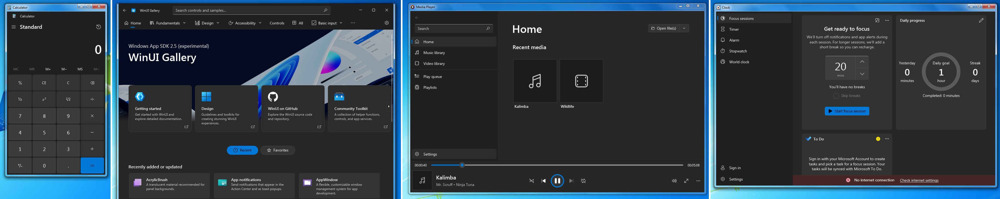

# WXR

Windows eXtended Runtime is a project that attempts to run UWP, Windows App SDK (WinUI 3) and GDK programs on Windows 7 SP1 x64. It uses Microsoft's own Windows 10 files, extracted from the official ISO into an environment folder (default `C:\WXR`), together with a loader layer that fills in what Windows 7 is missing.

## Requirements and installation

To run WXR you need:
- Windows 7 Service Pack 1 (64-bit)
- Platform Update for Windows 7 (KB2670838)
- VxKex (https://github.com/i486/VxKex), tested with 1.2.1.2229
- A Windows 10 22H2 64-bit ISO. You can get one at https://www.microsoft.com/en-gb/software-download/windows10: the page downloads the Media Creation Tool, which can create the ISO. Build 19045.3803 is the tested one; setup accepts other 22H2 builds with a warning.

Download the latest package from Releases and run `WxrInstaller.exe` (the GUI). It uses `wxrsetup.exe`, the command-line setup program, which is included too. Setup checks your computer first and tells you what is missing.

Administrator permissions are required and only used to add the required registry entries, enable VxKex for WXR's broker and add WXR to Programs and Features.

**Why an ISO?** WXR does not contain or distribute any Microsoft files. Setup copies the Windows 10 files it needs (about 450 MB) from your own ISO. The ISO is only read, and you can delete it afterwards. No product key or activation is needed.

Please consider lowering your expectations. A sizeable amount of apps, UI parts, features and performance may be non-functional or subpar. For now...?

### Optional components

Custom install (and Repair or Change later) lets you choose:
- **UWP apps** (on by default): Windows' own XAML, which most Store apps use. WinUI 3 apps are always supported and don't need it.
- **GDK games**: the runtime of PC games built with Microsoft's Game Development Kit. Setup downloads Microsoft's Gaming Services package (about 200 MB, internet needed) and keeps only the three runtime files it needs.
- **Microsoft account sign-in** (experimental): adds WXR Sign-in, so the Microsoft Store can use your account.

### After installing

WXR comes without apps. You can get them in these ways:
- From the **Microsoft Store**.
- With `wxrpkg store <ProductId>`, which installs free apps without an account.
- From **.msix / .appxbundle** files: open them with App Installer or install them with `wxrpkg add`, or with `Add-AppxPackage` in PowerShell.

Installed apps appear in the Start menu under **WXR**. **WXR > Tools** has **Uninstall apps** and, with the sign-in component, **WXR Sign-in**.

## Compatibility list

| Tested app | Functionality |
|---|---|
| Windows Calculator | Full functionality excluding Graphing mode. |
| Media Player | Proper file handling, MP3 and FLAC decoding and playback. Video playback is not functional. |
| Windows Clock | Partial functionality. |
| Microsoft Store | Renders correctly and can read and handle installed apps and packages. When signed in with WXR Sign-in it can install free apps; some fail for reasons not known yet. Showing the signed-in account and paid purchases do not work. |
| WinUI 3 Gallery | Functional for a large number of controls. |
| App Installer | Installs .msix / .appxbundle files. |
| Minecraft for Windows (Bedrock) | Playable with keyboard and mouse. No audio, internet connections, logging in or controllers; it runs as a trial. It cannot be installed from the Store. Add it with `wxrpkg add` from an existing installation (the XboxGames folder of a Windows 10 PC), with the GDK component installed. |



## Commands

Everything the GUI does can also be done from a command prompt. The tools are in `<root>\Layer`, except `wxrsetup.exe`, which is in `<root>\Setup`. `--root <folder>` picks the installation. Without it, the Layer tools use the installation they are in, and `wxrsetup` uses `%WXR_ROOT%`, else `C:\WXR`.

**Apps and packages: `wxrpkg`**

| Command | What it does |
|---|---|
| `wxrpkg add <package or folder>... [--dependency <package or folder>]... [--force-update] [--any-os]` | Installs .appx/.msix/.appxbundle/.msixbundle files or an unpacked package folder. `--dependency` supplies frameworks; `--any-os` skips the Windows version check. |
| `wxrpkg store <ProductId or PackageFamilyName> [--check \| --download-only]` | Downloads a free app and the frameworks it needs from Microsoft and installs them (no account used), for example `wxrpkg store 9WZDNCRFHVN5` (Calculator). |
| `wxrpkg list [--all-users] [--json] [--type main,framework,resource\|all] [--name <pattern>]` | Lists installed packages. |
| `wxrpkg remove <PackageFullName> [--preserve-data]` | Uninstalls a package; its app data is deleted unless `--preserve-data` is given. |
| `wxrpkg gdk [--remove] [--force-update]` | Sets up (or removes) the GDK game runtime; normally done by setup. |

PowerShell users get `Add-AppxPackage`, `Get-AppxPackage` and `Remove-AppxPackage`, which work on WXR's packages. Setup makes them available in every new PowerShell window.

**Starting apps: `wxr`**

| Command | What it does |
|---|---|
| `wxr activate <PackageFamilyName!AppId> [arguments]` | Starts an app, the way the Start menu shortcuts do. |
| `wxr sync` | Rebuilds the Start menu entries and icons of the installed apps. |
| `wxrsvc --wxr [<root>] stop` | Stops WXR's background broker (it starts by itself with the first app). |

**Tools**

| Command | What it does |
|---|---|
| `wxruninstall` | Uninstall apps: lists apps, then all packages; uninstalls the one you pick. |
| `wxrsignin [--status \| --signout]` | WXR Sign-in: signs a Microsoft account in with a code entered at microsoft.com/link (sign-in component only). |

**Setup: `wxrsetup`** (all commands take `--root <folder>`; `--yes` skips confirmations)

| Command | What it does |
|---|---|
| `wxrsetup check [system \| root]` | Checks this computer and/or the install folder. |
| `wxrsetup inspect <iso>` | Shows the Windows editions and build in an ISO, .esd or .wim. |
| `wxrsetup create` | Creates the installation folder. |
| `wxrsetup extract <iso> [--components uwp\|none]` | Copies the Windows 10 files from the ISO. |
| `wxrsetup components <uwp,gdk,msa \| none> [--iso <iso>]` | Installs the components named and removes the others. |
| `wxrsetup register` | Makes the registry changes WXR needs (administrator). |
| `wxrsetup install-layer <folder>` | Installs WXR's own files into `<root>\Layer`. |
| `wxrsetup status` | Shows what the installation contains. |
| `wxrsetup purge state \| image \| layer \| all` | Removes the apps and their data, the Windows 10 files, WXR's files, or everything, including its changes outside the folder. |

## Contributing

To contribute to this project, fork it and open a pull request; pull requests are reviewed. Describe in detail what your changes do and how you tested them.

### AI assistance

A significant amount of this project's code was written with AI assistance, mainly Claude Opus 5.5 and Sonnet 5.5. Suggestions for hand-written replacements are welcome.

Contributing AI-assisted code is allowed as long as you have a general understanding of what your code does.

## Building from source

Only needed to work on WXR itself. Contributors fetch the dependencies themselves.

| Path | What |
|---|---|
| `src\layer` | `wxrsys.dll`: in-memory loader + Win8/10 API implementations |
| `src\launcher` | `wxr.exe` (activate/sync), `wxrrun.exe` (debug launcher), `wxruninstall.exe` (Uninstall apps) |
| `src\broker` | `wxrsvc.exe`: shared broker, activation by AUMID |
| `src\dcomp` | our `dcomp.dll` (DirectComposition + Windows.UI.Composition) |
| `src\rtstub` | `wxrstub.dll`: WinRT stand-in classes generated from `classes.txt` + hand-written overrides |
| `src\wxrpkg` | `wxrpkg.exe`: package deployment, Store downloads, GDK runtime, Appx PowerShell module |
| `src\wxrsetup` | `wxrsetup.exe`: creates a root, extracts the Win10 files from the ISO (`data\files.txt`), components |
| `src\installer` | `WxrInstaller.exe`: the setup wizard (WinForms, .NET 3.5) |
| `src\msa` | WXR Sign-in (`wxrsignin.c`), kept apart from the rest |
| `data\ordmap` | ordinal -> name maps deployed to `Layer\ordmap` |
| `tools` | debug and run scripts; `tools\native` = native debug tools |

### Dependencies (not in git, under `deps\`)

- `deps\toolchain\x\mingw64`: winlibs MinGW-w64 (GCC 16.2.0, msvcrt, posix, seh); `deps\toolchain\wimlib`: wimlib 1.14.4 Windows binaries (for wxrsetup)
- `deps\winmd`: `.winmd` metadata (`winmd_system\` from the ISO's `System32\WinMetadata`, plus app winmds), used by the dcomp/rtstub generators
- `deps\symbols`, `deps\dbghelp.dll`: PDBs and Win10 dbghelp, for the debug tools only
- Python 3.8 with `dnfile` (generators); Visual Studio 2019 (the setup wizard only)

### Build and deploy

```
.\build.ps1                         # everything; or e.g. .\build.ps1 layer dcomp
.\build.ps1 installer package       # the setup wizard and the release package (out\package)
.\deploy.ps1 [-Root C:\WXR]         # copies out\ into <root>\Layer (refuses while WXR apps run)
```

`wxrrun [--root <folder>] <exe | AUMID> [arguments]` starts an app under a debugger and logs loaded DLLs, debug output and crashes to `wxrrun.log`.

## License

Licensed under the MIT License.

This project is not affiliated with Microsoft. It does not contain or distribute Microsoft software: the Windows 10 files come from your own ISO, and setup downloads Gaming Services from Microsoft.

### Third-party credits

- [miniz](https://github.com/richgel999/miniz) (MIT): zip reading in `wxrpkg`.
- [StoreLib](https://github.com/StoreDev/StoreLib) (MPL-2.0): the Windows Update request file used by `wxrpkg store`, kept unmodified.
- [wimlib](https://wimlib.net) (LGPLv3): `libwim-15.dll`, used by setup to read the Windows image. Shipped unmodified; source at wimlib.net.
- [VxKex](https://github.com/vxiiduu/VxKex): WXR runs on top of it (installed separately).
- wine-uwp: used as a reference for handling a few parts of this project.

The licences of shipped third-party code are included in the package's `licenses` folders.
